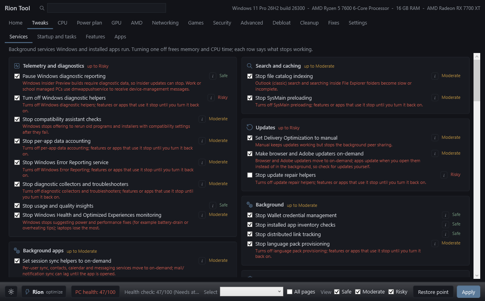
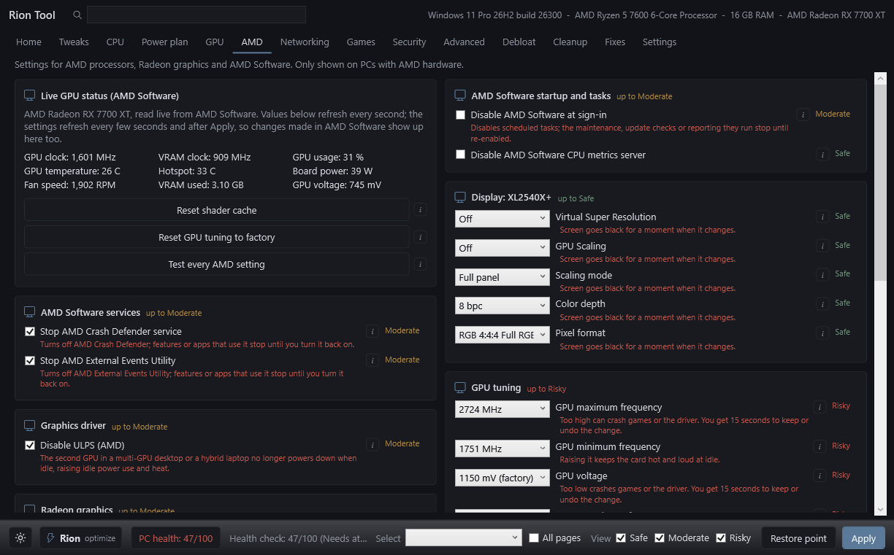
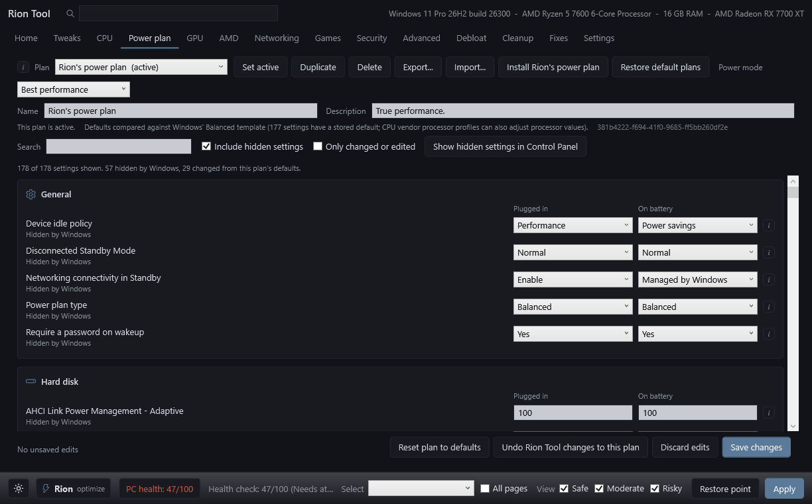
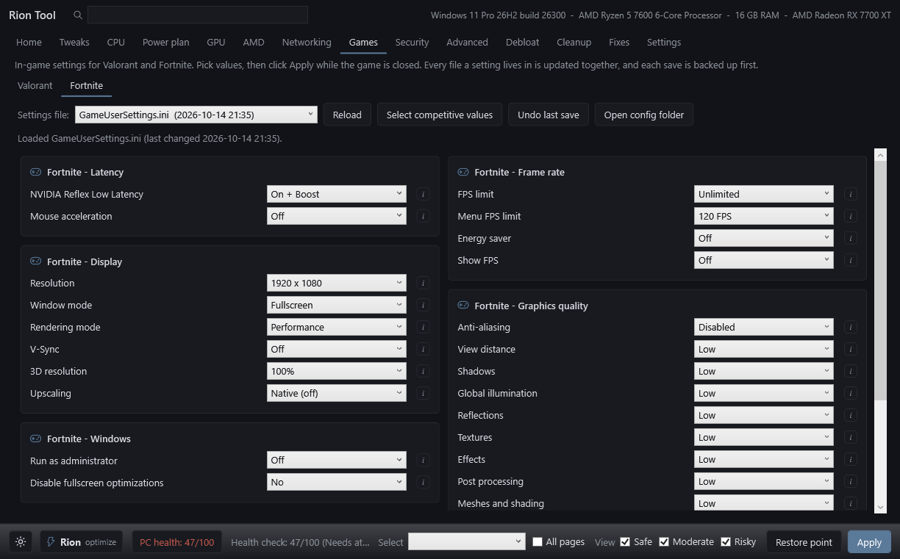
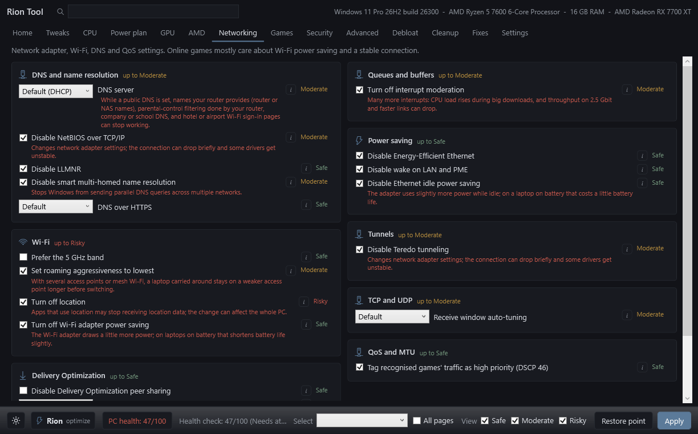
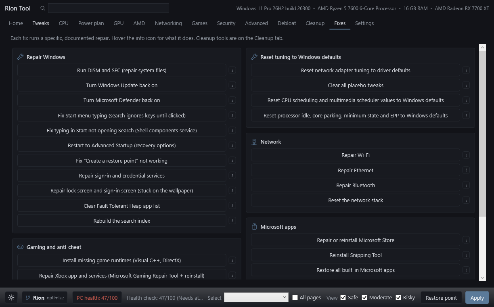
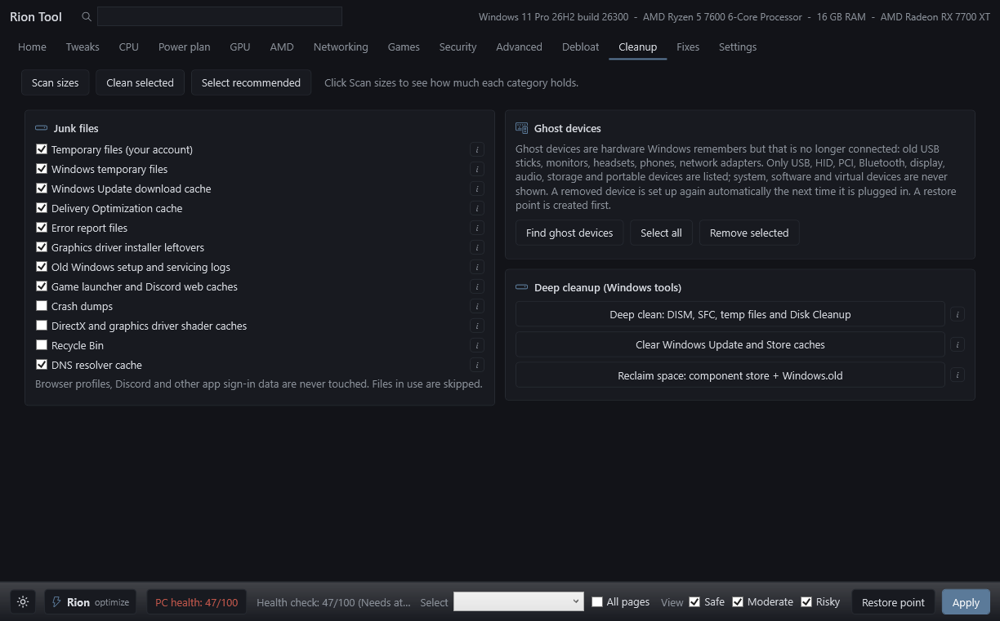

# Rion Tool

A Windows tweak tool for gaming PCs. It shows what each setting does and what it can break, and every change can be undone.

Works on Windows 11 and most of Windows 10. Needs administrator rights.

## Features

- **PC health check** with one-click fixes for drivers, services, runtimes and harmful old tweaks.
- **One-click optimize** that applies the Safe and Moderate gaming tweaks and cleans junk files.
- **About 400 tweaks** for services, startup apps, privacy, AI features, power, CPU, GPU, memory, storage, input and network. Each one is labelled Safe, Moderate or Risky.
- **AMD and NVIDIA tabs** with the driver app settings, read live from your GPU.
- **Power plan editor** with hidden settings and Rion's power plan.
- **Valorant and Fortnite settings editor** with a backup before every save.
- **Cleanup, repairs and debloat**, including turning Windows Update and Defender back on.
- **Profiles**: save your selection to a file and load it on another PC.

## Download and run

1. Download the latest zip from [Releases](../../releases) and extract it.
2. Double-click `Run-RionTool.bat` and accept the administrator prompt.
3. Start on the Home tab.

## Undoing changes

- Untick a setting and click Apply to put back its original value.
- **Fixes > Undo Rion Tool changes** reverts everything at once.
- Create a restore point first with the button on the Home tab.

## Screenshots

| | |
|---|---|
|  |  |
|  |  |
|  |  |

## Good to know

- Close a game before changing its settings, because games save their settings again when they exit.
- The NVIDIA profile buttons need [NVIDIA Profile Inspector](https://github.com/Orbmu2k/nvidiaProfileInspector/releases) next to `RionTool.ps1`.
- PowerRun is included for manual work only. Do not start Rion Tool through it.
- See [docs/Driver-Settings-Guide.md](docs/Driver-Settings-Guide.md) for settings you set by hand in the driver apps.

## Disclaimer

This tool changes system settings and cleanup deletes files. Use it at your own risk and create a restore point before large changes.
